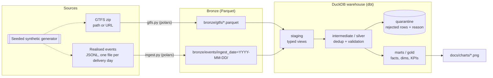
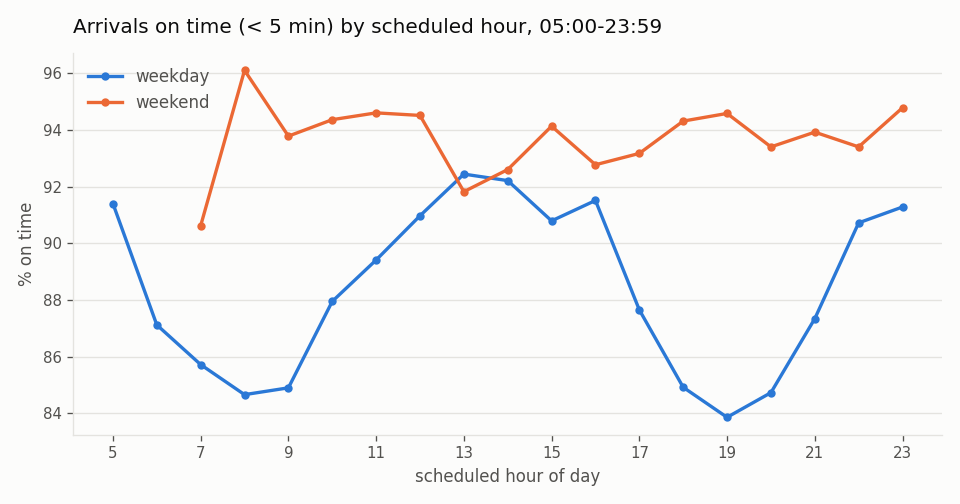
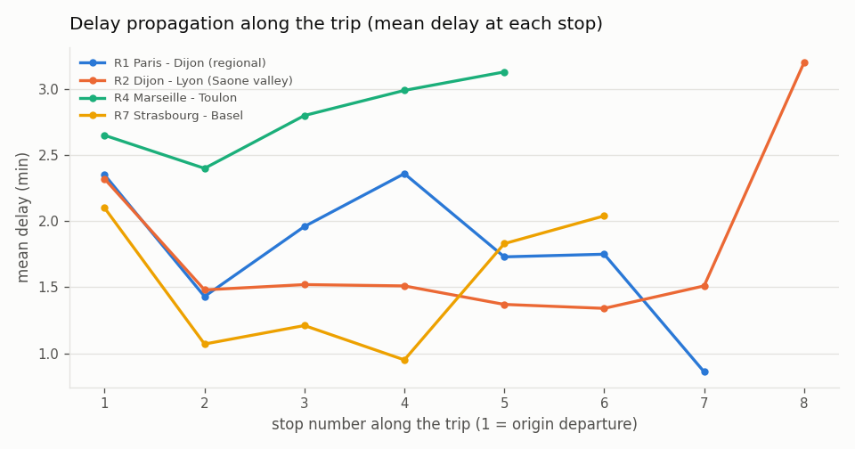
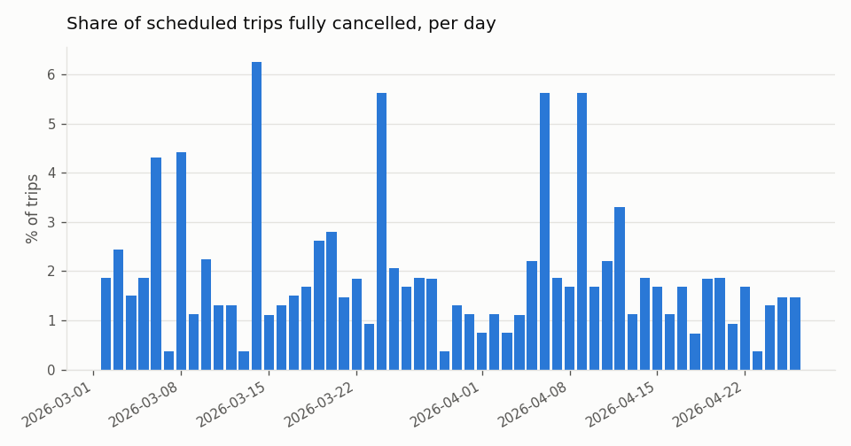

# RailData

**An ELT pipeline that turns railway timetables (GTFS) and realised arrival/departure events into tested punctuality, delay-propagation and cancellation marts, using Python, DuckDB and dbt.**

> **The data is synthetic.** Open operator APIs and data portals were not reachable from the
> environment where this was built, so a seeded generator produces a GTFS-style network
> (real French/Swiss station names and approximate coordinates; fictional operators,
> lines and timetables) and a stream of realised events. The ingestion layer does not
> depend on the generator: `raildata load-gtfs <path-or-url>` and
> `raildata run --gtfs <path-or-url>` accept any standard GTFS zip. That loader is tested
> on a zip built from the synthetic feed, including a nested folder layout, missing
> optional columns, a URL source, and a missing required file. No real operator feed has
> been run through it yet.

## Architecture



The `raildata run` CLI orchestrates one daily run or a backfill:
`generate (synthetic only) -> load GTFS -> ingest landing files -> dbt build (models + tests) -> metrics`.

## What each layer does

| Layer | Where | What happens |
|---|---|---|
| **Landing** | `data/landing/` | Files exactly as delivered: the GTFS zip and one `events/<delivery-date>.jsonl` per day. A delivery day contains that day's events plus *late* events from the previous service day. |
| **Bronze** | `data/bronze/` (Parquet) | Schema-enforced copy of landing, with lineage columns (`_source_file`, `_source_line`, `ingest_date`). No business rules. Events are Hive-partitioned by `ingest_date`, and each partition is overwritten atomically on re-run. GTFS tables are replaced atomically. |
| **Staging** | DuckDB `staging.*` (dbt views) | Typed views over bronze: GTFS times (which can exceed `24:00:00`) become second offsets, calendars become booleans and dates, and event codes are normalised. |
| **Intermediate / silver** | DuckDB `intermediate.*` | `int_events_ranked` ranks every delivered version of an event. `int_events_validated` keeps the latest version, joins the schedule, computes the delay and applies the quality rules. `int_scheduled_trips` expands the GTFS calendar (with `calendar_dates` exceptions) into the trips that should have run. |
| **Quarantine** | DuckDB `quarantine.dq_quarantine_events` | Every rejected record with its `dq_reason`. Nothing is silently dropped. |
| **Marts / gold** | DuckDB `marts.*` | `fct_stop_events` (**incremental**), `fct_trip_runs`, `dim_stops`, `dim_routes`, `mart_punctuality_line_daily`, `mart_punctuality_station`, `mart_punctuality_hourly`, `mart_delay_propagation`. |

**Incremental strategy.** `fct_stop_events` uses `delete+insert` keyed on `service_date`. Each run
rebuilds whole service-date partitions in `[start_date - lookback_days, end_date]`, which
works like partition overwrite. Late events delivered the next morning are therefore picked
up, and re-running a day leaves the table unchanged. The idempotency is tested (pytest) and
checked again in CI by running the same day twice and comparing row counts.

**Definitions.** A stop event is *on time* when its delay is under 5 minutes (configurable dbt
var `on_time_threshold_min`). Punctuality is measured on realised arrivals at every served
stop. *Cancellation rate* is the share of scheduled trips (from the GTFS calendar) whose
events are all `CANCELLED`. Partial cancellations are counted separately.

## Data-quality strategy

Problems in the delivered event stream are handled in dbt, in this order. Each record gets
the **first** rule it fails.

| # | Rule | `dq_reason` | What happens to the row |
|---|---|---|---|
| 1 | Same `event_id` delivered again with an identical payload | `duplicate_event` | Extra copies go to quarantine. One copy is kept. |
| 2 | Same `event_id` delivered again with a different payload; the latest `recorded_at` wins | `superseded_version` | The older version goes to quarantine. |
| 3 | `stop_id` not in GTFS `stops` | `unknown_stop_id` | Quarantined |
| 4 | No `(trip_id, stop_sequence)` in `stop_times` / stop differs from schedule | `no_matching_stop_time` / `stop_mismatch` | Quarantined |
| 5 | Status `OK` but no actual timestamp (or `CANCELLED` with one) | `missing_actual_ts` / `cancelled_with_actual_ts` | Quarantined |
| 6 | Delay above 360 min or below -60 min | `implausible_delay` | Quarantined |
| 7 | Within a trip run, the timestamp is more than 60 s earlier than the previous valid event | `out_of_order_timestamp` | Quarantined. Only rows that passed rules 1-6 are compared, so one bad row cannot taint its neighbours. |
| - | Event delivered in the next day's file | (not an error) | Accepted. The incremental lookback window re-processes the previous service date. |

On top of that, `dbt build` runs **57 data tests**:

- 20 `not_null`
- 10 `unique`
- 7 `accepted_values`
- 6 `relationships`
- 6 `unique_combination` (custom generic)
- 5 `value_between` (custom generic)
- 3 singular tests:
  - `assert_bronze_reconciles_with_clean_plus_quarantine`: every bronze row is either clean or quarantined.
  - `assert_clean_events_are_time_ordered`
  - `assert_cancelled_events_have_no_actual_time`

The generator records every anomaly it injects in a manifest
(`data/landing/events/_manifest/*.json`). The end-to-end pytest
(`tests/test_pipeline.py`) checks that the quarantine counts per reason match the manifest
exactly. It also checks that the clean row count per fully delivered day matches the
generator's clean count, and that every late event reaches the gold layer.

## Measured results

All numbers below come from one run: `make run`, a backfill of 56 delivery days from
2026-03-02 to 2026-04-26, seed 42. The run's output is committed as
[`docs/run_metrics.json`](docs/run_metrics.json).

**Rows per layer**

| Layer / table | Rows |
|---|---:|
| Landing records ingested = bronze `events` | 243,545 |
| Silver `int_events_validated` (one row per `event_id`) | 237,760 |
| Gold `fct_stop_events` (clean) | 235,675 |
| Quarantine `dq_quarantine_events` | 7,870 |
| Gold `fct_trip_runs` (scheduled trip x day) | 25,712 |
| Gold `mart_punctuality_line_daily` | 504 |
| GTFS: stops / routes / trips / stop_times | 43 / 9 / 806 / 4,546 |

Bronze 243,545 = clean 235,675 + quarantined 7,870. A dbt singular test checks this
reconciliation on every build.

**Rows quarantined, by reason**

| `dq_reason` | Rows |
|---|---:|
| `duplicate_event` | 3,471 |
| `superseded_version` | 2,314 |
| `out_of_order_timestamp` | 685 |
| `unknown_stop_id` | 685 |
| `missing_actual_ts` | 476 |
| `implausible_delay` | 239 |

Out-of-order and unknown-stop anomalies are both injected at the same configured rate (0.3 %
of clean events), which is why their counts are identical. 4,633 late-arriving events were
accepted into gold. Trip runs: 24,953 ran, 268 were partially cancelled, 491 were fully
cancelled.

**Output KPIs (synthetic data, so these describe the generator, not a real network):**

| KPI | Value |
|---|---:|
| Arrivals on time (< 5 min) | 88.85 % |
| Mean arrival delay | 1.71 min |
| P90 arrival delay | 5.68 min |

The service-date range starts on 2026-03-01 because the first delivery file carries late
events from the day before. `fct_trip_runs` only reports days whose own delivery has been
ingested.

**Runtime on 2 vCPUs.** The run was measured on a 2-vCPU Linux VM shared with another job
(load average around 3 during the run), with Python 3.13:

| Step | Seconds |
|---|---:|
| Synthetic generation (56 days) | 9.37 |
| GTFS load | 0.05 |
| Bronze ingest | 0.74 |
| `dbt build` (20 models + 57 tests) | 11.79 |
| **Total** | **21.95** |
| Wall clock for the whole `make run` | 22.7 |

A single daily incremental run (`raildata run --date ...`) took about 10-12 s on the same
machine. Almost all of that is dbt start-up plus rebuilding the silver tables (see
limitations).

## Charts

Generated by `raildata report` from the gold marts:



Weekday punctuality drops in the morning and evening rush hours. The generator amplifies
delays at those hours, and the marts recover the effect.



Mean delay at each stop along the trip (direction 0). Delay is gained from dwell time at
stations and from incidents, and recovered on long segments thanks to schedule padding. On
R1 Paris - Dijon, for example, the long last segment brings trains back towards on time.



Share of scheduled trips fully cancelled per day. The spikes are days on which the generator
simulated a line-level disruption.

## How to run

Requirements: Python 3.12+. Everything runs locally; no services are needed.

```bash
python -m venv .venv && source .venv/bin/activate
make install                      # pip install -e ".[dev]" (pinned versions)

make run                          # backfill 2026-03-02..2026-04-26, writes docs/run_metrics.json
make daily DATE=2026-04-27        # one daily incremental run; re-running it is a no-op
make report                       # charts -> docs/charts/
make test lint                    # pytest + ruff
make dbt-build                    # standalone `dbt build` on what is already in bronze
```

To use a real GTFS feed, run `raildata run --gtfs path/or/url.zip --no-generate --date ...`
with event files in `data/landing/events/<date>.jsonl`. The fields are `event_id`,
`service_date`, `trip_id`, `stop_id`, `stop_sequence`, `event_type` (`ARR`/`DEP`), `status`
(`OK`/`CANCELLED`), `actual_ts`, `recorded_at` and `source`. Loading only the static feed
is `raildata load-gtfs path/or/url.zip`.

Query the warehouse directly with `duckdb data/warehouse/raildata.duckdb`, for example
`select * from marts.mart_punctuality_line_daily limit 10;`.

**CI** (`.github/workflows/ci.yml`, ubuntu-latest, Python 3.12) runs:

- ruff (lint and format check)
- pytest
- the full 56-day pipeline
- a daily run executed twice, with an idempotency check
- a standalone `dbt build`
- the report, uploading the charts and metrics as artifacts

## Project structure

```
raildata/
├── src/raildata/
│   ├── network.py        # stations (real names, approx. coordinates), lines, operators
│   ├── generate.py       # seeded GTFS + realised-events generator, dirty-record injection
│   ├── gtfs.py           # GTFS zip loader (path or URL) -> bronze Parquet, with validation
│   ├── ingest.py         # landing JSONL -> bronze Parquet partition (idempotent)
│   ├── pipeline.py       # orchestration of a run + metrics collection
│   ├── report.py         # matplotlib charts from the marts
│   └── cli.py            # `raildata run | generate | load-gtfs | report`
├── dbt/
│   ├── models/staging/       # sources (external Parquet) + typed views
│   ├── models/intermediate/  # dedup ranking, validation, scheduled trips
│   ├── models/quarantine/    # dq_quarantine_events
│   ├── models/marts/         # facts, dims, KPI marts (+ schema tests)
│   ├── macros/               # custom generic tests, GTFS time parsing, schema naming
│   └── tests/                # singular tests
├── tests/                # pytest: generator, GTFS loader, ingest, end-to-end
├── docs/charts/          # committed charts
├── docs/run_metrics.json # output of the run quoted above
├── Makefile
└── .github/workflows/ci.yml
```

## Design choices and limitations

- **Orchestration is a CLI plus a Makefile, not Airflow, Prefect or Dagster.** Every step
  is idempotent and parameterised by date, so a scheduler would only need to call
  `raildata run --date {{ ds }}` daily. This keeps the project light enough to run in CI
  in a few minutes.
- **Silver is rebuilt in full on every run.** Only the gold fact table is incremental. At
  about 240k rows this costs a few seconds. At larger volumes the dedup and validation
  models would also need to be windowed by `service_date`.
- **Timestamps are local, timezone-naive Europe/Paris times.** DST transitions are not
  handled.
- **The delay model is plausible, not calibrated** against real operator statistics. It
  combines a heavy-tailed origin delay, a rush-hour factor, per-line reliability, dwell
  and incident delays, recovery from schedule padding, and occasional line disruptions.
- No Dockerfile is provided. The project is pure Python with an embedded database, so a
  virtualenv is enough.
